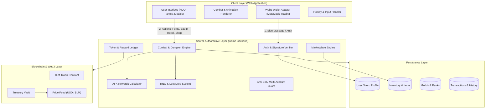
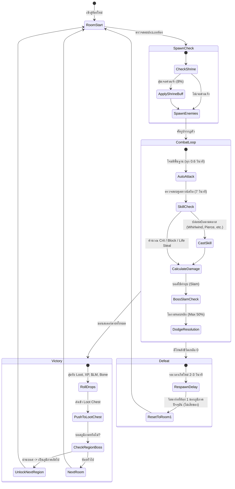
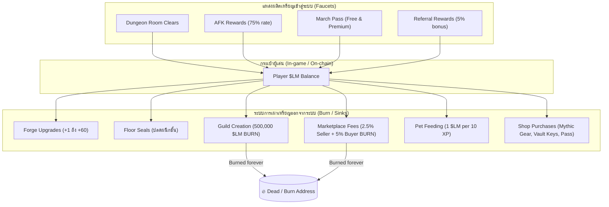
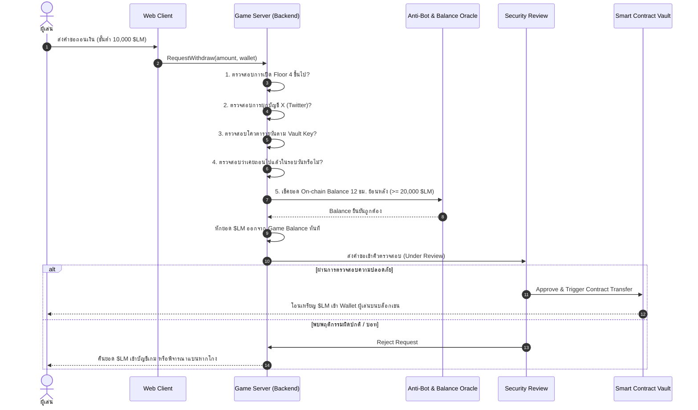

# โครงสร้างและสถาปัตยกรรมระบบเกม LootMarch (Game Architecture & System Design DOCS)

เอกสารนี้ระบุรายละเอียดโครงสร้างเชิงระบบ (System Architecture), วงจรการทำงานของเกม (Core Game Loop), โครงสร้างข้อมูล (Data Schemas), สูตรคำนวณทางคณิตศาสตร์ (Game Mathematics & Formulas) และโมเดลเศรษฐกิจ (Tokenomics Flow) ของเกม **LootMarch**

---

## 📌 สารบัญ (Table of Contents)
1. [สถาปัตยกรรมระบบโดยรวม (System Architecture Overview)](#1-สถาปัตยกรรมระบบโดยรวม-system-architecture-overview)
2. [วงจรการทำงานหลักของเกม (Core Game Loop & State Machine)](#2-วงจรการทำงานหลักของเกม-core-game-loop--state-machine)
3. [โครงสร้างโมเดลข้อมูล (Entity Data Models & Schemas)](#3-โครงสร้างโมเดลข้อมูล-entity-data-models--schemas)
4. [สูตรการคำนวณทางคณิตศาสตร์ของเกม (Game Math & Formulas)](#4-สูตรการคำนวณทางคณิตศาสตร์ของเกม-game-math--formulas)
5. [ระบบเศรษฐกิจและการหมุนเวียนเหรียญ (Tokenomics Flow: Faucets & Sinks)](#5-ระบบเศรษฐกิจและการหมุนเวียนเหรียญ-tokenomics-flow-faucets--sinks)
6. [ระบบความปลอดภัยและการทำธุรกรรม (Security & Transaction Architecture)](#6-ระบบความปลอดภัยและการทำธุรกรรม-security--transaction-architecture)

---

## 1. สถาปัตยกรรมระบบโดยรวม (System Architecture Overview)

LootMarch ออกแบบสถาปัตยกรรมในรูปแบบ **Server-Authoritative Web3 Game** โดยที่ตรรกะเกม การต่อสู้ การดรอปไอเทม และการคำนวณรางวัลทั้งหมดจะถูกประมวลผลและตรวจสอบโดย Server เพื่อป้องกันการโกง ส่วนหน้าบ้าน (Client) ทำหน้าที่เพียงแสดงผล (Rendering) และรับคำสั่งจากผู้เล่นเท่านั้น



### รายละเอียดแต่ละเลเยอร์:
1. **Client Layer (หน้าบ้าน):**
   - พัฒนาด้วย Web Standard จัดการแสดงผลกราฟิก อนิเมชันตัวละคร หน้าต่างกระเป๋า (Inventory), ค่าสถานะ (Stats), แผนที่ (Travel) และร้านค้า (Shop)
   - เชื่อมต่อกระเป๋า Web3 ผ่าน EIP-712 / Personal Sign ในการยืนยันตัวตน
2. **Server-Authoritative Layer (เซิร์ฟเวอร์หลัก):**
   - **Combat & Dungeon Engine:** จำลองการต่อสู้ (Tick rate), จัดการคูลดาวน์สกิล (ทุก 7s), การคำนวณบัฟศาลเจ้า และการเกิดใหม่ของมอนสเตอร์
   - **RNG & Loot Engine:** สุ่มไอเทมดรอป คำนวณ Rarity และไอเทมเข้า Loot Chest
   - **AFK Calculator:** คำนวณผลผลิตออฟไลน์ย้อนหลังอิงจากข้อมูลการเล่นจริง 24 ชั่วโมงล่าสุด
   - **Anti-Bot Guard:** สแกนพฤติกรรม ตรวจสอบการเปิดหลายบัญชี และตรวจสอบสิทธิ์การถือครอง 20,000 $LM
3. **Blockchain & Web3 Layer:**
   - เหรียญ $LM (On-chain Token), Smart Contract คลังรับฝาก (Treasury), ระบบเช็ค Balance กระเป๋า และระบบแปลงราคา Real-time USD ต่อ $LM

---

## 2. วงจรการทำงานหลักของเกม (Core Game Loop & State Machine)

### 2.1 วงจรการลุยห้องดันเจี้ยน (Room State Machine)



---

## 3. โครงสร้างโมเดลข้อมูล (Entity Data Models & Schemas)

### 3.1 ตัวละครผู้เล่น (Hero Entity)
```typescript
interface Hero {
  id: string;
  walletAddress: string;          // ผูกกับกระเป๋าเงิน (1 Hero ต่อ Wallet)
  name: string;                   // ชื่อตัวละคร
  class: 'sword' | 'spear' | 'wand' | 'axe' | 'dagger';
  level: number;                  // เลเวลตัวละคร (เริ่มต้น 1)
  currentXP: number;              // XP สะสมในเลเวลปัจจุบัน
  power: number;                  // ค่าคะแนนพลังรบโดยรวม
  
  // แต้ม Attributes (1 แต้มต่อเลเวล)
  attributes: {
    strength: number;             // +2 Damage ต่อแต้ม
    vitality: number;             // +8 Health ต่อแต้ม
    agility: number;              // +2 Speed, +1% Dodge ต่อแต้ม
    defense: number;              // +1% Block ต่อแต้ม
    vampirism: number;            // +0.25% Life Steal ต่อแต้ม (สูงสุด 20 แต้ม)
  };

  // อุปกรณ์สวมใส่ 7 ช่อง
  equipment: {
    weapon: Item | null;
    helmet: Item | null;
    armor: Item | null;
    shield: Item | null;
    boots: Item | null;
    ring: Item | null;
    amulet: Item | null;
  };

  equippedPetId: string | null;   // สัตว์เลี้ยงที่สวมใส่อยู่ (ได้ครั้งละ 1 ตัว)
  
  // ตำแหน่งในดันเจี้ยนปัจจุบัน
  dungeonProgress: {
    currentFloor: number;         // ชั้นปัจจุบัน (เช่น Floor 1)
    currentRegionIndex: number;   // ภูมิภาคปัจจุบัน (1 - 11)
    currentRoom: number;          // ห้องปัจจุบันในภูมิภาคนั้น
    maxUnlockedFloor: number;     // ชั้นสูงสุดที่ปลดผนึกแล้ว
    maxUnlockedRegion: number;    // ภูมิภาคสูงสุดที่ผ่านแล้ว
    travelCooldownUntil: Date;    // Timestamp คูลดาวน์การ Travel (30 นาที)
  };
}
```

### 3.2 ไอเทมและอุปกรณ์ (Item Entity)
```typescript
type ItemRarity = 'common' | 'uncommon' | 'rare' | 'epic' | 'legendary' | 'mythic';
type ItemSlot = 'weapon' | 'helmet' | 'armor' | 'shield' | 'boots' | 'ring' | 'amulet';

interface Item {
  id: string;                     // Unique Item ID (ของแต่ละชิ้นมี ID เฉพาะตัว)
  name: string;
  slot: ItemSlot;
  rarity: ItemRarity;
  requiredClass?: 'sword' | 'spear' | 'wand' | 'axe' | 'dagger'; // สำหรับ Weapon เท่านั้น
  
  baseStats: {
    damage?: number;
    health?: number;
    defense?: number;
    speed?: number;
    critChance?: number;
    lifeSteal?: number;
    skillCooldownReduction?: number;
  };

  forgeLevel: number;             // ระดับการตีบวก (0 ถึง +60)
  lmEarningsBonus: number;        // โบนัสเพิ่มการได้รับ $LM (เฉพาะของตีบวกหรืออาวุธ Mythic)
  isLocked: boolean;              // สถานะล็อกไอเทม (ป้องกันการขาย/ย่อย)
}
```

### 3.3 สัตว์เลี้ยง (Pet Entity)
```typescript
type PetType = 'leafhopper' | 'shellby' | 'craboulder' | 'emberkit';

interface Pet {
  id: string;
  type: PetType;
  rarity: ItemRarity;             // สัตว์เลี้ยงมี 6 ระดับความหายาก
  level: number;                  // เลเวลสูงสุด 10
  currentXP: number;              // XP สัตว์เลี้ยง (1 Bone = 10 XP + 1 $LM)
  skill: {
    name: string;
    effectDescription: string;
    value: number;                // ค่าประสิทธิภาพ เพิ่มขึ้น 10% ต่อเลเวล
  };
  isLocked: boolean;
}
```

### 3.4 ข้อมูลเศรษฐกิจผู้เล่น (Economy & Wallet State)
```typescript
interface PlayerEconomyState {
  walletAddress: string;
  gameLMBalance: number;          // ยอดเงินในเกม (In-game balance)
  boneBalance: number;            // ยอดกระดูกวัตถุดิบ (Bone)
  onChainLMBalance: number;       // ยอดที่ถือจริงในกระเป๋า (เช็คย้อนหลัง 12 ชม.)
  
  dailyEarnings: {
    dateUTC: string;              // ว-ด-ป (Reset 00:00 UTC)
    lmEarnedToday: number;        // ยอดรวมฟาร์มวันนี้ (สำหรับคิดเพดาน Daily Line)
    roomsClearedToday: number;    // สูงสุด 400 ห้องต่อวัน (คิด Pass XP)
  };

  vaultKey: {
    tier: 'none' | 'bronze' | 'silver' | 'golden';
    expiresAt: Date | null;
  };

  lastWithdrawAt: Date | null;    // ถอนได้วันละ 1 ครั้ง
}
```

---

## 4. สูตรการคำนวณทางคณิตศาสตร์ของเกม (Game Math & Formulas)

### 4.1 สูตรคำนวณเลเวลตัวละคร (Character Leveling Curve)
- เลเวล 1 ไป เลเวล 2 ต้องการ:
  $$\text{XP}_{\text{Req}}(2) = 250\text{ XP}$$
- ตั้งแต่เลเวล 3 ขึ้นไป อัตราการเติบโตแบบ Exponential เพิ่มขึ้น 16% ทุกเลเวล:
  $$\text{XP}_{\text{Req}}(L) = 1,000 \times (1.16)^{L - 2} \quad (L \ge 3)$$

### 4.2 สูตรการสเกลความยากของดันเจี้ยน (Dungeon Monster Scaling)
คำนวณความแข็งแกร่งของมอนสเตอร์ตามดัชนีภูมิภาคสะสม ($R$):
$$\text{HP}(R) = \text{BaseHP} \times (1.40)^{R - 1}$$
$$\text{Damage}(R) = \text{BaseDMG} \times (1.35)^{R - 1}$$
*(โดยที่แต่ละชั้นมี 11 ภูมิภาค ชั้นที่ 2 ภูมิภาคที่ 1 จะมีค่า $R = 12$)*

### 4.3 สูตรค่าใช้จ่ายในการปลดผนึกชั้น (Floor Seal Cost Formula)
ค่าใช้จ่ายในการปลดผนึกชั้นที่ $F$ ($F \ge 2$):
$$\text{Cost}_{\$LM}(F) = 3,000 \times 2^{F - 2}$$
$$\text{Cost}_{\text{Bone}}(F) = 800 \times 2^{F - 2}$$

### 4.4 สูตรการเพิ่มพลังจากการตีบวก (Forge Stat Scaling)
สเตตัสรวมหลังตีบวกระดับ $+N$ (สูงสุด $N = 60$):
$$\text{Stat}(N) = \text{BaseStat} \times \left(1 + N \times M_{\text{rarity}}\right)$$
โดยที่ค่าตัวคูณความหายาก ($M_{\text{rarity}}$) คือ:
- **Common:** $0.04$ (+4%/เลเวล)
- **Uncommon:** $0.05$ (+5%/เลเวล)
- **Rare:** $0.06$ (+6%/เลเวล)
- **Epic:** $0.08$ (+8%/เลเวล)
- **Legendary:** $0.11$ (+11%/เลเวล)
- **Mythic:** $0.15$ (+15%/เลเวล)

### 4.5 สูตรการย่อยไอเทมที่ตีบวกแล้ว (Forged Salvage Formula)
$$\text{Bone}_{\text{Salvage}} = \text{BaseBone}_{\text{rarity}} + 0.25 \times \sum_{i=1}^{N} \text{BoneCost}(i)$$
*(เหรียญ $LM$ ที่เคยใช้ตีบวกจะไม่ได้รับคืน)*

### 4.6 สูตรการคำนวณรางวัลออฟไลน์ (AFK Rewards Calculation)
$$\text{Reward}_{\text{AFK}} = \text{Duration}_{\text{hours}} \times \left(\overline{\text{Rate}}_{\text{last24h}} \times 0.75\right)$$
- โดยจำกัดระยะเวลาสะสม: $\text{Duration}_{\text{hours}} = \min(\text{TimeElapsed}, 8.0)$

### 4.7 โบนัสการถือเหรียญในกระเป๋า (Holder Bonus Tier)
คำนวณจากยอดคงเหลือต่ำสุดของมูลค่า $LM ในกระเป๋าในรอบ 12 ชั่วโมง ($\text{MinUSD}_{12h}$):
$$\text{Bonus}_{\text{Holder}} = \begin{cases} 
25\% & \text{เมื่อ } \text{MinUSD}_{12h} \ge \$1,000 \\
15\% & \text{เมื่อ } \text{MinUSD}_{12h} \ge \$300 \\
10\% & \text{เมื่อ } \text{MinUSD}_{12h} \ge \$100 \\
5\% & \text{เมื่อ } \text{MinUSD}_{12h} \ge \$20 \\
0\% & \text{เมื่อ } \text{MinUSD}_{12h} < \$20 
\end{cases}$$

---

## 5. ระบบเศรษฐกิจและการหมุนเวียนเหรียญ (Tokenomics Flow: Faucets & Sinks)



### การควบคุมอัตราเงินเฟ้อ (Anti-Inflation Mechanisms):
1. **Daily Line Decay:** จำกัดอัตราการได้รับ $LM รายวัน เมื่อฟาร์มเกินเพดาน ผลตอบแทนจะลดลงเหลือ 50% และ 20%
2. **Heavy Burn Points:**
   - การสร้างกิลด์เผาทำลายเหรียญ **500,000 $LM** ทันที
   - ค่าธรรมเนียมตลาด 7.5% รวม (ผู้ขาย 2.5% + ผู้ซื้อ 5%) ถูกเผาทำลายทั้งหมด 100%
   - ค่าปลดผนึกชั้นเพิ่มเป็น 2 เท่าแบบทวีคูณ (Exponential)

---

## 6. ระบบความปลอดภัยและการทำธุรกรรม (Security & Transaction Architecture)

### แผนผังขั้นตอนการถอนเงิน (Withdrawal Verification Flow)



### มาตรการรักษาความปลอดภัย (Security Rules):
1. **Zero Private Key Exposure:** เซิร์ฟเวอร์ไม่เคยมีส่วนเกี่ยวข้องกับกุญแจส่วนตัว (Private Key) หรือรหัสลับ (Seed Phrase) ของผู้เล่น
2. **Server-Side Authorization:** สิทธิ์การดรอปไอเทม คำนวณความเสียหาย และการคำนวณเหรียญถูกคำนวณบนเซิร์ฟเวอร์แบบปิด 100%
3. **Sybil / Multi-Account Defense:** จำกัดจำนวนกระเป๋าที่เข้าสู่ระบบจากเครื่องเดียวกัน และมีการตรวจสอบความเร็วในการเคลียร์ห้องแบบผิดธรรมชาติ
