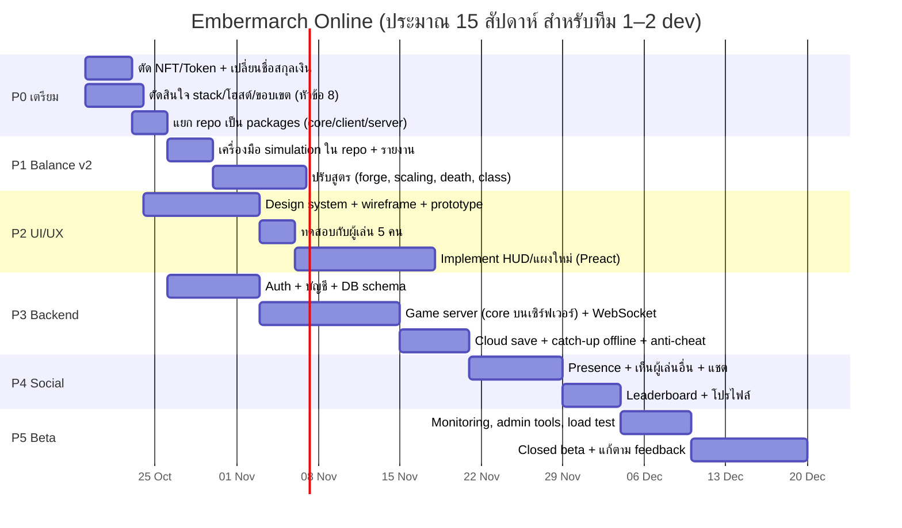
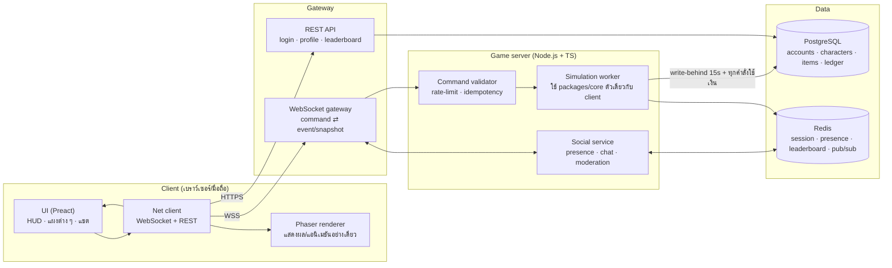
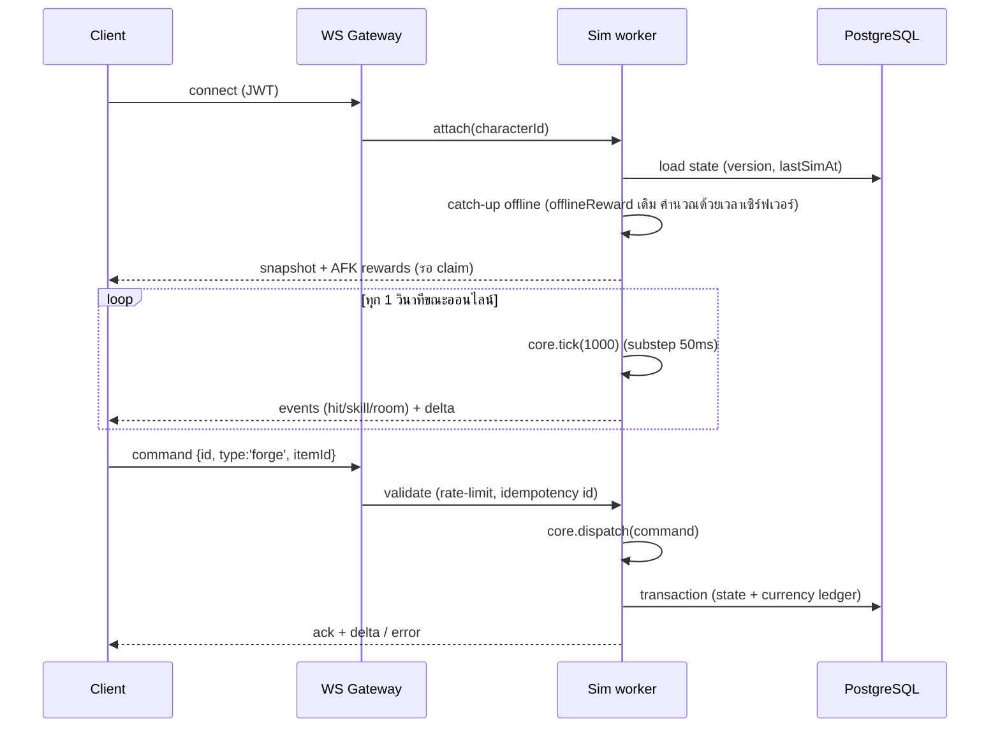
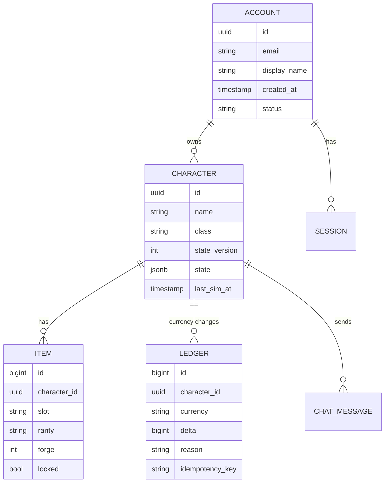
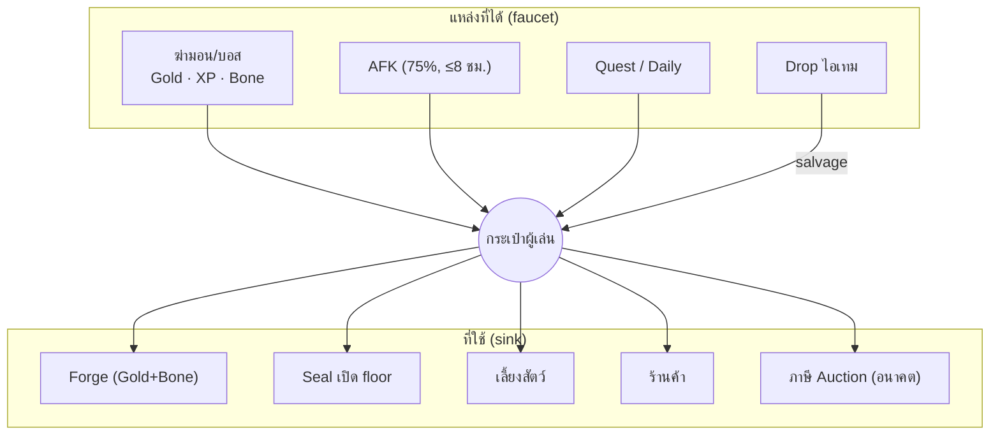
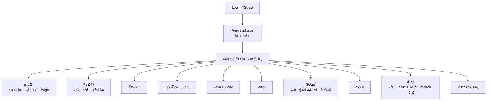
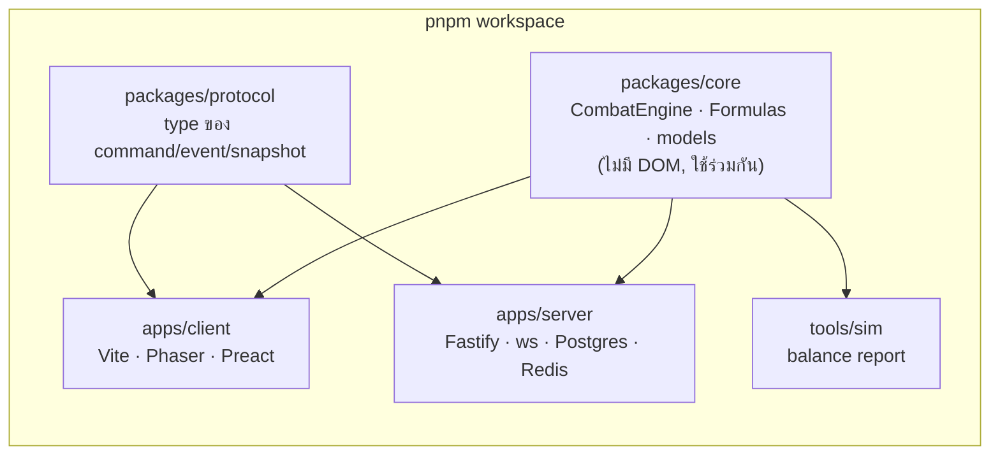

# แผนงาน: Embermarch Online (UI/UX ใหม่ · Balance ใหม่ · ตัด NFT/Token)

> สถานะ: **ร่างแผน** รอยืนยันข้อตัดสินใจในหัวข้อ 8 · วันที่ 2026-10-17
> แผนภาพทั้งหมดเขียนเป็น Mermaid (เปิดบน GitHub หรือ VS Code + Markdown Preview Mermaid ได้)

## 0. เป้าหมาย

| จาก (ตอนนี้) | ไป (เป้าหมาย) |
| --- | --- |
| เกม idle เล่นคนเดียว เซฟใน LocalStorage | เกมออนไลน์ มีบัญชีผู้เล่นและเซฟบนเซิร์ฟเวอร์ |
| สกุลเงิน `$LM` ตั้งใจให้ผูกกับ token/wallet | สกุลเงินในเกมล้วน (**Gold** + **Bone**) ไม่มีมูลค่านอกเกม |
| เครื่องผู้เล่นเป็นตัวตัดสินผล (โกงได้) | **เซิร์ฟเวอร์เป็นตัวตัดสิน** (server-authoritative) ส่วน client มีหน้าที่แสดงผลอย่างเดียว |
| Balance ไม่เคยวัดค่าจริง | Balance วัดด้วย simulation ทุกครั้งที่แก้ และมีเกณฑ์ผ่าน/ไม่ผ่าน |
| HUD หนาแน่น, ไม่มี onboarding, ปุ่ม Marketplace ที่ไม่ทำงาน | UI ที่ออกแบบใหม่ทั้งระบบ เน้นมือถือ มี social (แชต อันดับ ผู้เล่นอื่น) |

หลักการ: **ไม่มี NFT, token, wallet, การถอนเงิน หรือการซื้อขายของในเกมด้วยเงินจริง** ถ้าจะหารายได้ในอนาคต ให้ขายเฉพาะของตกแต่ง (cosmetic) ที่ไม่เพิ่มพลัง

---

## 1. ภาพรวมแผน (Roadmap)

P1 (Balance) กับ P2 (UI/UX) ทำคู่ขนานกับ P3 (Backend) ได้ เพราะ core ถูกแยกเป็น package กลางตั้งแต่ P0

---

## 2. ตัด NFT / Token (P0)

สิ่งที่พบในโค้ดตอนนี้ (ยังไม่มี wallet จริง มีแค่คำและ UI ที่เตรียมไว้):

| จุด | สิ่งที่มี | แผน |
| --- | --- | --- |
| สกุลเงิน `$LM` (UI, log, CombatEngine) | ชื่อแบบ token ticker | เปลี่ยนเป็น **Gold** · ใน state ใช้ `gold` แทน `lm` ด้วย save migration v2→v3 |
| `.wallet` (HTML/CSS) | กล่องแสดงเงินชื่อ wallet | เปลี่ยนชื่อเป็น `.purse` / `currency-bar` |
| Footer "Simulated currency · No wallet connected" | ข้อความ Web3 | ลบ |
| แผง **Marketplace** (ปุ่ม M) | "requires … wallet integration" | ลบออกจาก P0 แล้วค่อยกลับมาเป็น **Auction House** (ใช้ Gold เท่านั้น) ในเฟสหลัง launch |
| `docs/GAME_STRUCTURE_DOCS.md`, `LOOTMARCH_*`, `CODEX_PROMPT.md` | สถาปัตยกรรม Web3, Holder Bonus, Tokenomics, Price Oracle | ย้ายไปไว้ใน `docs/archive/` และติดป้ายว่า "อ้างอิงเกมต้นแบบ ไม่ใช่สเปกของเรา" |
| `ARCHITECTURE.md` หัวข้อ "Production and Web3 migration" | แนวทางผูก wallet | เขียนใหม่เป็น "Online architecture" ตามหัวข้อ 3 |
| Holder Boost (ภาพอ้างอิง) | โบนัสตามจำนวนเหรียญที่ถือ | **ไม่ทำ** ถ้าต้องการให้รางวัลคนเล่นต่อเนื่อง ให้ใช้ระบบ daily login/season pass ที่ไม่ใช้เงินแทน |

เกณฑ์ว่าเสร็จ: `grep -ri "wallet\|token\|\$LM\|nft\|web3" src/` ต้องไม่เจอ (ยกเว้น auth token) และ test ผ่านทั้งหมด

---

## 3. สถาปัตยกรรมออนไลน์ (P3)

### 3.1 ภาพรวมระบบ

**ข้อได้เปรียบ:** `src/core` เป็น TypeScript ล้วน ไม่มี DOM ใช้ seed RNG และ `s.now` อยู่แล้ว จึงย้ายไปรันบนเซิร์ฟเวอร์ได้แทบไม่ต้องแก้ ทั้ง client และ server ใช้ package เดียวกัน (`packages/core`)

### 3.2 การไหลของคำสั่ง (server เป็นตัวตัดสิน)

- Client **ไม่ส่งผลการต่อสู้** ส่งแค่ "คำสั่ง" (equip, forge, travel, …) ฝั่ง Phaser ยังวาดแอนิเมชันเหมือนเดิมจาก events ที่ได้รับ
- เวลาและ RNG อยู่ที่เซิร์ฟเวอร์ (seed ไม่ส่งให้ client)
- ถ้าเข้าระบบ 2 ที่พร้อมกัน ที่ใหม่จะเตะที่เก่าออก (ใช้แทน Web Lock เดิม)
- โหลด: core ใช้ 20 substep/วินาที/คน → 1,000 คนออนไลน์ ≈ 20k step/s ซึ่งเครื่องเดียวรับได้ · คนที่ออฟไลน์ไม่ต้อง tick (คำนวณย้อนหลังตอนกลับมา)

### 3.3 ข้อมูลหลัก (เริ่มแบบง่าย)

เริ่มด้วย `state` แบบ JSONB (ใช้ `GameState` ตัวเดิม + `validateSave`) แล้วค่อยแยกตาราง item ออกมาเมื่อทำ Auction House · ทุกการเปลี่ยนแปลงเงินเขียนลง `LEDGER` เพื่อใช้ตรวจสอบและจับการโกง

### 3.4 ฟีเจอร์ออนไลน์

| ลำดับ | ฟีเจอร์ | หมายเหตุ |
| --- | --- | --- |
| MVP | บัญชี + cloud save · เล่นต่อได้ทุกเครื่อง | login: Email + Google/Discord, รองรับ guest แล้วผูกบัญชีทีหลัง |
| MVP | จำนวนคนออนไลน์ · **เห็นผู้เล่นอื่นใน region เดียวกัน** (ตัวละคร+ป้ายชื่อแบบในภาพอ้างอิง) | เป็นแค่การแสดงผล (ghost) ไม่ได้สู้ร่วมกัน |
| MVP | แชต global/region + กรองคำหยาบ + report/mute | rate-limit |
| MVP | Leaderboard: region สูงสุด, พลัง, จำนวนบอส | Redis sorted set |
| หลัง launch | Guild · World boss แบบร่วมมือ (รวมดาเมจทั้งเซิร์ฟ) | |
| หลัง launch | Auction House (Gold เท่านั้น + ภาษี 5–10% เป็น gold sink) | ไม่มีการแลกเปลี่ยนกับเงินจริง |
| หลัง launch | Season (รีเซ็ตอันดับ + รางวัล cosmetic) | |

---

## 4. Balance v2 (P1)

### 4.1 ค่าปัจจุบันจาก simulation (core จริง, seed เดียว)

บอทจำลองผู้เล่นแบบปกติ: claim/equip best ทุกนาที, ลงแต้มสลับ Vitality/Strength, salvage ของเหลือ, forge ของที่ใส่, เปิด seal ทันทีที่มีเงินพอ

| ตัวชี้วัด | ผล | ปัญหา |
| --- | --- | --- |
| เคลียร์ Floor 1 (11 region) | **8 นาที** | เร็วเกิน เนื้อหาหมดเร็ว |
| รอเงินเปิด seal Floor 2 | ~63 นาทีโดยไม่มีอะไรให้ทำ | ช่วงที่ไม่มีอะไรเกิดขึ้น |
| Floor 2 (region 12–22) | ~60 นาที | ยังเร็วเกินไป |
| Floor 3 (region 24→27) | 279 → 661 นาที | กำแพงชัน |
| ตายใน 12 ชม. | **901 ครั้ง** | วนตายที่บอสซ้ำไปเรื่อย ๆ ไม่มีการถอยกลับไปฟาร์ม |
| ดาเมจ/HP ที่ 12 ชม. | 11,562 / 50,135 | forge โตแบบทวีคูณ (`1.15^60` ≈ 4,384× สำหรับ Mythic) |
| คลาส (3 ชม.) | Sword ดาเมจ 2,256 vs Dagger 994 · Wand ตาย 217 vs Sword 83 | คลาสห่างกันมาก |
| เลเวล | Lv 20 ที่ 25 นาที, Lv 40 ที่ 7.9 ชม. | ต้นเกมเร็วเกิน |

### 4.2 เป้าหมาย pacing (เสนอ ต้องยืนยัน)

| ช่วง | เป้า (ผู้เล่น active + idle) |
| --- | --- |
| บอสตัวแรก | 8–12 นาที |
| จบ Floor 1 | 3–5 ชั่วโมง (วันแรก) |
| จบ Floor 2 | 2–3 วัน |
| จบ Floor 3 | 1–2 สัปดาห์ (แล้วมี season/content ใหม่ต่อ) |
| ตายตอน push ที่เหมาะกับเลเวล | < 4 ครั้ง/ชั่วโมง |
| คลาส | ความเร็วเคลียร์ต่างกันไม่เกิน ±10% · แต่ละคลาสมีจุดเด่นของตัวเอง |
| ที่มาของพลัง | forge ≤ 40%, gear ฐาน ~30%, attribute+level ~30% ช่วงปลายเกม |

### 4.3 สิ่งที่จะปรับ

1. **Forge:** เปลี่ยนจากทวีคูณเป็นแบบเส้นตรงที่ช้าลงเรื่อย ๆ เช่น `base × (1 + rate × forge^0.85)` และตั้งเพดานตามระดับ floor
2. **Monster scaling:** ลดจาก `1.4^(R−1)` เป็นราว `1.22^(R−1)` แล้วเพิ่มตัวคูณตอนข้าม floor ให้การขึ้น floor ใหม่รู้สึกยากขึ้นแบบมีจังหวะ ไม่ใช่กำแพงต่อเนื่อง
3. **ความตาย:** ถ้าตายที่บอสติดกัน 3 ครั้ง ให้ถอยไป region ก่อนหน้าโดยอัตโนมัติแล้วฟาร์ม (ปิดได้) และแสดงคำแนะนำ "ควร forge/ลงแต้ม"
4. **Seal cost:** คิดจากรายได้ต่อชั่วโมงของ floor นั้น (≈ 45–60 นาทีของการฟาร์ม) และระหว่างรอให้มีของทำ เช่น daily quest
5. **XP curve:** ทำให้ต้นเกมช้าลง (Lv 10 ประมาณ 25 นาที) และให้ช่วงกลางลื่นขึ้น
6. **คลาส:** Dagger เพิ่มคริ (ตัวตนของคลาส), Axe ให้ stun บ่อยขึ้น/มีโล่, Wand เพิ่ม HP พื้นฐานหรือให้ตีจากระยะไกลจริง (ศัตรูต้องเดินเข้ามาก่อน)
7. **Drop/storage:** ใช้เพดานเดิม (300/150) และเพิ่มการตั้ง auto-salvage ตาม rarity

### 4.4 วิธีทำงาน (สำคัญที่สุด)

- ย้าย simulation เข้า repo ที่ `tools/sim` ให้ทดสอบหลาย seed หลาย policy (idle อย่างเดียว / active / คลาสละ 1) แล้วออกรายงานเป็น CSV/Markdown
- ตั้งเกณฑ์ใน CI: ถ้า pacing หลุดจากช่วงในหัวข้อ 4.2 ให้ test ล้ม
- ทุกครั้งที่แก้สูตร ให้รัน sim แล้วแนบตารางก่อน/หลังไว้ใน PR
- Balance ใหม่ต้องใช้กับเซฟใหม่ (เริ่มออนไลน์) จะไม่ย้อนไปแก้เซฟ local เก่า

---

## 5. UI/UX ใหม่ (P2)

### 5.1 ปัญหาปัจจุบัน

- HUD บังพื้นที่เล่น (การ์ด 4 ใบซ้าย + แผนที่ขวา ที่ 1024px) และบนมือถือต้องเลื่อนแถบเมนูข้าง
- ทุกอย่างเป็น modal แบบเดียวกัน ไม่มีหน้า "บ้าน" ไม่มี onboarding และไม่มีหน้า Settings (เสียง, reduced motion, ภาษา)
- ตัวเลขไม่มี tooltip/การเปรียบเทียบ เช่นของใหม่ดีกว่าของเดิมเท่าไร
- โค้ด UI อยู่ในไฟล์เดียว 22 KB เป็นบรรทัดยาว แก้ยากและ test ไม่ได้

### 5.2 แผนผังหน้าจอใหม่

### 5.3 สิ่งที่ต้องส่งมอบ

1. **Design system:** สีเป็น token (มีโหมด dark อยู่แล้ว), ฟอนต์ 3 ชุด (Cormorant = หัวข้อ, DM Sans + **Noto Sans Thai** = เนื้อหา, Silkscreen = ตัวเลขในเกม), ระยะห่าง, ปุ่ม, การ์ด, tooltip
2. **HUD ใหม่:** แถบบน (ชื่อ/เลเวล/HP/XP + เงิน), แถบบอส, minimap ย่อได้, แถบเมนูล่าง 5 ปุ่มหลัก + ปุ่ม "เพิ่มเติม" และกล่องแชตย่อได้
3. **Onboarding 3 ขั้น:** เลือกคลาส → สู้ห้องแรก (มีคำอธิบาย) → claim ของ/equip best
4. **i18n:** ไทย/อังกฤษ (ตอนนี้ข้อความ hardcode เป็นภาษาอังกฤษ)
5. **เทคนิค:** ย้าย UI ไปใช้ **Preact + signals** (ประมาณ 4 KB) แยก component ทีละแผง เพื่อรับ state ที่ stream มาจากเซิร์ฟเวอร์ได้ง่าย และเขียน component test ได้
6. **กระบวนการ:** wireframe → prototype ที่คลิกได้ → ทดสอบกับผู้เล่น 5 คน → implement → วัดผลด้วย analytics (เวลาถึงบอสแรก, อัตรากลับมาเล่นวันที่ 1/7)

---

## 6. โครงสร้าง repo ใหม่ (P0)

---

## 7. ความเสี่ยง

| ความเสี่ยง | ผลกระทบ | ทางรับมือ |
| --- | --- | --- |
| ค่าเซิร์ฟเวอร์/ดูแลระบบ | รายจ่ายต่อเดือนและงาน on-call | เริ่มด้วยเซิร์ฟเวอร์เดียว + Postgres แบบ managed ที่สิงคโปร์ |
| โกง/บอท | อันดับไม่ยุติธรรม | server เป็นตัวตัดสิน, rate-limit, ledger, ตรวจจับอัตราได้เงินที่ผิดปกติ |
| ข้อมูลส่วนบุคคล (PDPA) | ต้องมีนโยบายความเป็นส่วนตัว | เก็บข้อมูลเท่าที่จำเป็น และให้ลบบัญชีได้ |
| แชตไม่เหมาะสม | ชุมชนเสีย | กรองคำ, report, mute, ปิดแชตได้ |
| เซฟ local เดิม | ผู้เล่นอยากย้ายความคืบหน้า | ดูข้อตัดสินใจ D5 |
| Scope บาน | ไม่ได้ launch | ยึด MVP ในหัวข้อ 3.4 ไว้ |

---

## 8. ข้อตัดสินใจที่ต้องยืนยันก่อนเริ่ม

| # | เรื่อง | ข้อเสนอ |
| --- | --- | --- |
| D1 | ชื่อสกุลเงิน | **Gold** + Bone |
| D2 | Backend stack | Node.js + TypeScript (ใช้ core ร่วม) · Fastify + ws · PostgreSQL + Redis |
| D3 | โฮสต์ | 1 region (สิงคโปร์) · VPS/PaaS + managed Postgres |
| D4 | Login | Email + Google/Discord + guest |
| D5 | เซฟ local เดิม | **เริ่มใหม่ทั้งหมด** พร้อมให้ของตกแต่ง "Founder" กับคนที่มีเซฟเก่า (เพราะเซฟ local แก้ได้และไม่น่าเชื่อถือ) |
| D6 | การหารายได้ | ยังไม่ทำ · ถ้าทำในอนาคต ขายเฉพาะ cosmetic ที่ไม่เพิ่มพลัง |
| D7 | UI framework | Preact + signals |
| D8 | ระดับความเป็นออนไลน์ใน MVP | เห็นผู้เล่นอื่น + แชต + อันดับ (ยังไม่สู้ร่วมกันแบบ real-time) |

---

## 9. ขั้นแรกที่ทำได้ทันที (ไม่ต้องรอ backend)

1. P0 ตัด NFT/Token + เปลี่ยน `$LM` → Gold (save v3 migration) — ประมาณ 1–2 วัน
2. ย้าย simulation เข้า `tools/sim` + รายงาน baseline (ตัวเลขในหัวข้อ 4.1) — ประมาณ 1 วัน
3. แยก repo เป็น workspace packages — ประมาณ 1–2 วัน
4. เริ่ม wireframe HUD ใหม่
