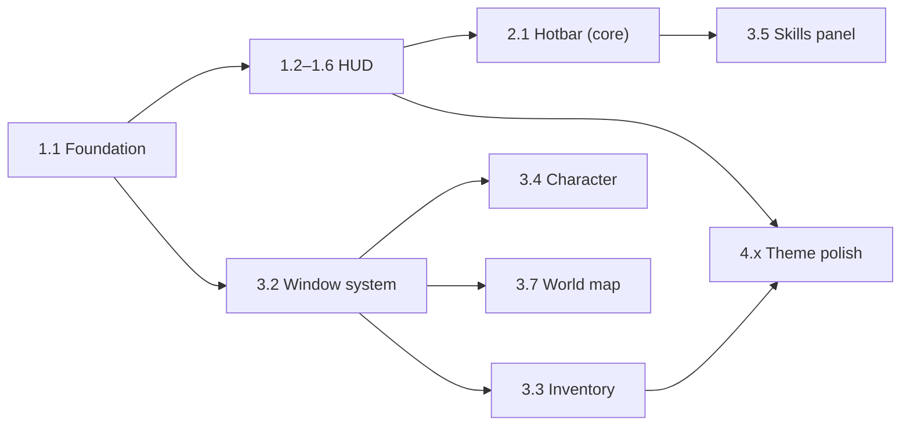

# แผนพัฒนา UI/UX / GUI — Thai Fantasy MMORPG

> สถานะ: **กำลังทำ** · เสร็จแล้ว: 1.1, 1.2, 1.3 (2026-10-17) · ดูหน้า design system ได้ที่ `/design.html` ตอนรัน `pnpm dev` · เป็นส่วนขยายของเฟส P2 ใน [ONLINE_PLAN.md](ONLINE_PLAN.md)
> ภาพอ้างอิง 2 ชุด: **A** "The Shattered Siam" (pixel art โทนมืด, ทองกับไม้, 3 อาชีพ) และ **B** "Siam Spirit Chronicles" (chibi นุ่มนวล สว่าง, 4 อาชีพ)
> ใช้เป็น **ทิศทางภาพ** เท่านั้น งานจริงต้องวาดและออกแบบใหม่ทั้งหมด ไม่คัดลอกภาพหรือ asset จากภาพอ้างอิง
> รหัสงาน (เช่น `1.3`) ตรงกับเช็กลิสต์ที่ใช้เลือกงาน

---

## 0. ข้อตัดสินใจที่ต้องยืนยันก่อน (ภาพอ้างอิงขัดกับเกมตอนนี้)

| # | เรื่อง | ตัวเลือก | ข้อเสนอ |
| --- | --- | --- | --- |
| U1 | สไตล์ภาพ | A มืด pixel / B chibi สว่าง / ผสม | **ผสม:** กรอบ UI และบรรยากาศใช้แบบ A (ไม้เข้ม + ทอง + ฟ้าวิญญาณ) ส่วนตัวละครยังเป็น pixel 16px แบบที่ทำไว้ และใช้ palette อุ่นจาก B ตอนกลางวัน |
| U2 | จำนวนอาชีพ | A=3 / B=4 / ตอนนี้=5 | **คง 5 ไว้ก่อน** แล้วตั้งชื่อธีมไทยใหม่ ถ้าจะลดจำนวนต้องทำพร้อม Balance v2 |
| U3 | รูปแบบการต่อสู้ | ออโต้ (idle) / กดเอง / ผสม | **ผสม:** Hotbar กดสกิลเองได้ และแต่ละช่องมีปุ่ม Auto (ค่าเริ่มต้นเปิด) จึงยังเล่นแบบ idle ได้ |
| U4 | ทรัพยากรสกิล (MP) | เพิ่ม MP / ใช้แค่ cooldown | **เพิ่ม MP** (แถบที่ 2 ใต้ HP) ต้องแก้ core + save migration v3 |
| U5 | ชื่อโลกและสถานที่ | คง Embermarch / ตั้งชื่อไทยใหม่ | ตั้งชื่อ 11 region ใหม่เป็นสถานที่ไทยแฟนตาซี (ดูข้อ 1.2) แต่ชื่อเกมรอตัดสินใจ |
| U6 | UI framework | vanilla เดิม / Preact | **Preact + signals** (ตรงกับ D7 ใน ONLINE_PLAN) |

---

## 1. UI/UX Component Breakdown

ช่อง "ตอนนี้" อ้างอิงโค้ดปัจจุบัน (`src/ui/UIManager.ts`, `src/game/scenes/CatacombScene.ts`)

### 1.1 หน้าจอหลัก / In-Game HUD

```
┌──────────────────────────────────────────────────────────────────────┐
│ [รูป] ชื่อ  Lv.252          ชื่อพื้นที่ (ป้ายกลาง)     ◷ 21:37  ┌────┐ │
│ HP ████████████            แถบ HP บอส (เมื่อมี)              │มินิ│ │
│ MP ██████████                                                │แมพ │ │
│ [buff][buff][buff]                                           └────┘ │
│                                                     ┌ ภารกิจที่ติดตาม ┐ │
│                        (พื้นที่เล่น)                 │ • เส้นทางแห่ง… │ │
│                                                     │ • …     (0/5)  │ │
│ ┌ แชต [ทั้งหมด|ทั่วไป|ระบบ|กระซิบ] ┐                 └───────────────┘ │
│ │ [ทั่วไป] …                    │                                     │
│ │ [ระบบ] …                      │  [1][2][3][4][5][R]   ⚙เมนู: ตัวละคร  │
│ └ พิมพ์ข้อความ…            [😊] ┘                        กระเป๋า ทักษะ   │
│                                                         แผนที่ ภารกิจ ตั้งค่า │
└──────────────────────────────────────────────────────────────────────┘
```

| องค์ประกอบ | ตอนนี้ | ต้องทำ |
| --- | --- | --- |
| Player frame (รูป ชื่อ Lv HP MP buff) | มีการ์ด HP/XP ไม่มี MP และ buff | กรอบทอง วงรูป, HP/MP มีตัวเลข, XP บาง, buff (shrine, สัตว์เลี้ยง) พร้อมเวลาถอยหลัง |
| Minimap (วงกลม + เวลา + ชื่อพื้นที่ + ปุ่ม M) | กล่องจุดห้อง 1–5 | มินิแมพวงกลมแสดงห้องในรูปแบบ node เส้นทาง ประตู บอส และ "ผู้เล่นอื่น" (ออนไลน์) |
| Quest tracker (ด้านขวา) | การ์ด Room objective | รายการ 3 เควสที่ติดตาม มี progress เช่น (0/5) คลิกแล้วไปที่ journal |
| Chat box (แท็บ + ช่องพิมพ์) | Field notes (log ซ่อนอยู่) | ช่องแท็บ ทั้งหมด/ทั่วไป/ระบบ/กระซิบ ตอนนี้แสดงแค่ "ระบบ" (log) ส่วนแชตจริงรอ backend |
| Skill hotbar (1–5 + R) | ป้าย Auto skill อันเดียว | 6 ช่อง มี cooldown แบบวงกวาด, ปุ่มลัด, auto toggle, tooltip |
| เมนูหลัก (ไอคอนขวาล่าง) | 7 ปุ่มใหญ่ + Loot chest | แถวไอคอนเล็กกระชับ มี badge แจ้งเตือน (เช่น ทักษะ ①) และปุ่มลัด |
| ป้ายชื่อ/ตัวเลขดาเมจ/แถบบอส | ✅ มีแล้ว | ปรับให้เข้าธีม (ข้อ 4) |

### 1.2 ระบบแผนที่โลก (World Map)

| องค์ประกอบ | รายละเอียด |
| --- | --- |
| Skeleton | แผ่นกระดาษเก่า มีทิศเข็มทิศ และ legend (เส้นทางบก, เส้นทางน้ำ, สถานที่สำคัญ) |
| Key locations | ตั้งชื่อไทยแฟนตาซีให้ 11 region ใหม่ (ต้นฉบับของเรา) เช่น หมู่บ้านริมคลอง → ตลาดน้ำโคมทอง → ป่าวิญญาณ → … → ประตูนรกเพลิง ตัวละครแต่ละ floor = 1 แผ่นดิน |
| สถานะ | ล็อก / ปลดแล้ว / อยู่ที่นี่ / เคลียร์บอสแล้ว (ใช้ `s.unlocked`, `s.cleared` เดิม) |
| การโต้ตอบ | hover แล้วเห็นเลเวลแนะนำและรางวัล · คลิกเพื่อ travel (มี cooldown เดิม) · ปุ่ม Seal เปิด floor ถัดไป |
| เทคนิค | วาดเป็น SVG (เส้นทาง + จุด) บนพื้นผิวกระดาษ ซูมและแพนได้ มือถือเป็นแบบเต็มจอ |

### 1.3 หน้าต่างตัวละคร อาชีพ และสเตตัส

| หน้าต่าง | เนื้อหา |
| --- | --- |
| เลือก/สร้างตัวละคร | การ์ดอาชีพแบบในภาพ A (ภาพใหญ่ + ชื่อไทย/อังกฤษ + บทบาท + สกิลเด่น 3 ภาพ), ช่องชื่อ (มีแล้ว), หมุนดูตัวละคร (turnaround แบบภาพ B) |
| ตัวละคร (C) | paper-doll สวมใส่ 7 ช่อง · สถิติหลัก/รอง · ลงแต้ม attribute · เปลี่ยนชื่อ (มีแล้ว) |
| ทักษะ (K) | สกิลของอาชีพ 5–6 ตัว (ใช้กับ hotbar) อัปเกรด ลากลง hotbar ได้ · ต้องเพิ่มระบบใน core |
| สัตว์เลี้ยง (P) | การ์ดสัตว์เลี้ยงแบบ monster sample ของภาพ B |

### 1.4 สไตล์และธีมภาพรวม

| หัวข้อ | กำหนด |
| --- | --- |
| Palette หลัก | Warm Gold `#E8A93B` · Leaf Green `#4E8F3A` · Terracotta `#B5533A` · Teal/Jade `#2F8F86` · Sky Blue `#5AA9E6` · Lotus Pink `#E68BB0` |
| Palette UI มืด | ไม้เข้ม `#1E140F` · หมึกน้ำเงิน `#121726` · ขอบทอง `#C9973F` / ไฮไลต์ `#F3D28A` · Spiritual Blue `#5FC8FF` (เวท/กลางคืน) |
| ฟอนต์ | หัวข้อตกแต่ง: **Srisakdi** (ไทยโบราณ) · หัวข้อ UI: **Kanit** · เนื้อหา: **Sarabun** · ตัวเลขในเกม: Silkscreen (EN) / Kanit (TH) |
| ลวดลาย | กรอบไทยแบบ 9-slice (ลายกนก/กระจัง) **วาดใหม่เป็น SVG** · มุมกรอบประดับ · ไอคอนดอกบัว/เปลวไฟวิญญาณเป็นเครื่องหมายเวท |
| Lighting mood | กลางวัน (อุ่น) / เย็น (โรแมนติก) / พื้นที่วิญญาณ (ฟ้าเรือง) / กลางคืน (ทองตะเกียง) ใช้ tint ของ scene + เปลี่ยน token UI |

---

## 2. Development & Implementation Phases

ทุกงานต้องผ่านเกณฑ์กลาง (Definition of Done): ทำงานบน desktop 1280px และมือถือ 375px · ไม่มี console error · คีย์บอร์ดใช้ได้ · ข้อความผ่าน i18n (TH/EN) · มี test ถ้าแตะ core

### Phase 1 — Core HUD & Player Information (~2 สัปดาห์)

| รหัส | งาน | ไฟล์/เทคนิค | เกณฑ์เสร็จ |
| --- | --- | --- | --- |
| 1.1 ✅ | **Foundation:** design tokens (สี, ฟอนต์ไทย, spacing) + component กรอบ `Frame` + ติดตั้ง Preact | `src/ui/theme/tokens.css`, `src/ui/components/Frame.tsx`, `design.html` | หน้า demo แสดงสี/ฟอนต์/กรอบครบ |
| 1.2 ✅ | Player frame: รูป ชื่อ Lv HP/**SP**/XP + buff | `src/ui/hud/PlayerFrame.tsx` · ตอนนี้ SP = การชาร์จสกิลอัตโนมัติ (7 วิ) **ยังไม่ใช่ MP จริง** (รอ U4) | HP/SP ขยับลื่น (tween) ตัวเลขตรงกับ state |
| 1.3 ✅ | Minimap วงกลม: node ห้อง ประตู บอส เวลา ชื่อพื้นที่ ปุ่ม M | `src/ui/hud/Minimap.tsx` (SVG) · ปุ่ม/คีย์ **M** = แผนที่โลก (Marketplace ไม่มีคีย์ลัดแล้ว) | ห้องปัจจุบันชัด คลิกแล้วเปิดแผนที่โลก |
| 1.4 | Quest tracker ด้านขวา (ติดตามได้ 3 รายการ) | `QuestTracker.tsx` | progress อัปเดตสด และย่อได้ |
| 1.5 | Top bar: ชื่อพื้นที่ (ป้ายกลาง), เงิน Gold/Bone, ปุ่มตั้งค่าด่วน | `TopBar.tsx` | ไม่บังพื้นที่เล่นเกิน 12% ของความสูงจอ |
| 1.6 | Layout grid + safe areas + โหมด UI scale (90–125%) | `HudLayout.tsx` | ไม่มีองค์ประกอบทับกันที่ 375/768/1280/1920px |

### Phase 2 — Action & Combat Interface (~2 สัปดาห์)

| รหัส | งาน | ไฟล์/เทคนิค | เกณฑ์เสร็จ |
| --- | --- | --- | --- |
| 2.1 | Skill hotbar 1–5 + R: วง cooldown, ปุ่มลัด, auto toggle, tooltip | `Hotbar.tsx` + core: command `cast` + สกิลหลายตัวต่อคลาส | กดเองหรือ auto ก็ได้ผลเท่ากัน · มี test ใน core |
| 2.2 | ตัวเลขดาเมจ v2: ปกติ/คริ/ฮีล/บล็อก/หลบ/ธาตุ + ตั้งค่าลดความถี่ | `CatacombScene` popup + settings | อ่านออกที่ 60fps · ปิดได้ |
| 2.3 | Target frame + ป้ายชื่อศัตรู + แถบบอสมี phase | `TargetFrame.tsx` | คลิกศัตรูแล้วเลือกเป้าได้ |
| 2.4 | Hit feedback: กระพริบ, สั่นเบา ๆ, VFX สกิลแยกตามคลาส (เวทฟ้าวิญญาณ, สายฟ้า, หิน) | Phaser particles | เคารพ reduced motion |
| 2.5 | ระบบปุ่มลัด + ตั้งค่าเปลี่ยนปุ่ม (remap) + หน้า "ปุ่มลัด" | `keybinds.ts` | เปลี่ยนแล้วบันทึกไว้ ไม่ชนกับช่องพิมพ์ |
| 2.6 | Chat/System box แบบแท็บ (ตอนนี้ใช้ log ระบบ, แชตจริงอยู่ใน ONLINE P4) | `ChatBox.tsx` | แท็บกรองได้ เลื่อนดูย้อนหลังได้ |

### Phase 3 — Menus & Navigation (~3 สัปดาห์)

| รหัส | งาน | ไฟล์/เทคนิค | เกณฑ์เสร็จ |
| --- | --- | --- | --- |
| 3.1 | แถบเมนูหลัก (ไอคอน + badge + ปุ่มลัด) | `MainMenu.tsx` | badge แสดงเมื่อมีแต้ม/ของใหม่ |
| 3.2 | ระบบหน้าต่าง: ลากหรือปักหมุดได้บน desktop, เป็น sheet เต็มจอบนมือถือ, ESC ปิด, focus trap | `WindowManager.tsx` | เปิดได้ 2 หน้าต่างพร้อมกันบน desktop |
| 3.3 | กระเป๋า: grid ช่อง, กรอบสีตาม rarity, tooltip เทียบของที่ใส่อยู่, กรอง/เรียง, auto-salvage | `Inventory.tsx` | 300 ช่องไม่หน่วง (virtual list) |
| 3.4 | หน้าตัวละคร: paper-doll + สถิติ + attribute + ชื่อ | `CharacterPanel.tsx` | เปลี่ยนของแล้วเห็นตัวเลขเปลี่ยน (+/-) ทันที |
| 3.5 | หน้าทักษะ (ลากลง hotbar) | `SkillsPanel.tsx` | ต้องทำ 2.1 ก่อน |
| 3.6 | สมุดภารกิจ (หลัก/รอง/รายวัน) | `QuestJournal.tsx` | ติดตามหรือเลิกติดตามแล้ว sync กับ 1.4 |
| 3.7 | แผนที่โลกแบบกระดาษ + key locations + travel/seal | `WorldMap.tsx` (SVG) | ทุก region คลิกได้ สถานะถูกต้อง |
| 3.8 | หน้าตั้งค่า: เสียง, ภาษา TH/EN, motion, ตัวเลขดาเมจ, UI scale, ปุ่มลัด | `Settings.tsx` | ค่าที่ตั้งยังอยู่หลัง reload |
| 3.9 | หน้าเลือก/สร้างตัวละครใหม่ (การ์ดแบบ A + turnaround) | `CharacterSelect.tsx` | ใช้ชื่อและอาชีพเดิมจาก core |

### Phase 4 — Polish, Theme & Consistency (~2 สัปดาห์)

| รหัส | งาน | ไฟล์/เทคนิค | เกณฑ์เสร็จ |
| --- | --- | --- | --- |
| 4.1 | กรอบลายไทยแฟนตาซี 9-slice (SVG ต้นฉบับ) + มุมประดับ + เส้นคั่น | `assets/ui/frames/*.svg` + CSS `border-image` | ใช้ชุดเดียวกันทุกหน้าต่าง |
| 4.2 | ไอคอนเซ็ตธีมไทย (เมนู, slot, buff, สกุลเงิน) | `src/ui/icons/` SVG | ไม่มีไอคอนที่ใช้สัญลักษณ์ Unicode เหลืออยู่ |
| 4.3 | Typography ไทย/อังกฤษ: scale, line-height ไทย, ตัวเลข | tokens | ไม่มีสระลอยหรือโดนตัด (ทดสอบคำ "ปิ่น ญี่ ฎุ") |
| 4.4 | โหมดสี Warm Gold / Spiritual Blue + lighting mood ตามพื้นที่ | theme switch | เปลี่ยนตามพื้นที่โดยอัตโนมัติ |
| 4.5 | Motion + เสียง UI (เปิด/ปิด/hover/ได้ของ) | CSS + SoundFX | มี reduced motion และปิดเสียงได้ |
| 4.6 | i18n ครบทุกข้อความ (TH เป็นค่าเริ่มต้น) | `src/i18n/th.ts`, `en.ts` | ไม่มี string hardcode ใน component |
| 4.7 | QA: contrast AA, focus, screen reader label, เมทริกซ์อุปกรณ์, งบประสิทธิภาพ (HUD < 2ms/frame) | checklist + Playwright screenshot | ผ่านทุกข้อ |

---

## 3. ลำดับที่แนะนำ



เริ่มที่ **1.1 Foundation** เสมอ เพราะทุกงานใช้ token, ฟอนต์ และกรอบชุดเดียวกัน · งานที่ต้องแก้ core (2.1, MP ใน 1.2, 3.5) ให้ทำ test ไปพร้อมกัน · งานแชตจริงและผู้เล่นอื่นในมินิแมพต้องรอ backend (ONLINE_PLAN P3–P4)

## 4. วิธีสั่งงาน

เลือกงานจากเช็กลิสต์ แล้วพิมพ์หรือกดส่ง เช่น `เริ่มงาน 1.1, 1.2` ทุกงานจะได้ commit แยก + อัปเดต HANDOFF + ภาพหน้าจอก่อน/หลัง
